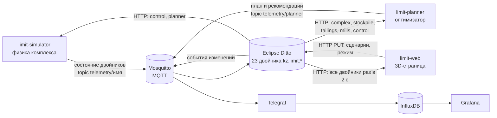

# Как устроен «Рудник под лимитом»

Этот документ объясняет, как работает решение целиком: какие сервисы запущены, как по ним идут данные, что считает симулятор, как оптимизатор строит план и что показывает интерфейс. Его стоит прочитать перед защитой: здесь есть ответы на вопросы «откуда эта цифра» и «почему так».

Коротко: **симулятор** изображает работу комплекса и пишет состояние в двойники Ditto, **оптимизатор** читает двойники, строит план на сутки и пишет его в свой двойник, симулятор работает по этому плану, а **3D-страница** и **Grafana** показывают всё это из платформы. Сценарии «что если» — это переключатели в отдельном двойнике `control`.

---

## 1. Сервисы

`make up` поднимает платформу OpenEgiz и четыре наших сервиса из [compose.yml](compose.yml).

| Сервис | Что делает | Код |
|---|---|---|
| `limit-setup` | Один раз при старте создаёт 23 двойника в Ditto и завершается | [engine/setup_twins.py](engine/setup_twins.py) |
| `limit-simulator` | Каждые 2 секунды делает шаг модели и публикует состояние всех двойников | [engine/simulator.py](engine/simulator.py) |
| `limit-planner` | Модуль-оптимизатор: строит суточный план и рекомендации | [engine/planner.py](engine/planner.py), [engine/lp.py](engine/lp.py) |
| `limit-web` | nginx: отдаёт 3D-страницу и пропускает её запросы к Ditto | [web/](web/) |

Все числа модели (производительности, лимиты, содержания, удельные расходы) лежат в одном файле — [engine/params.py](engine/params.py). Симулятор и оптимизатор берут их оттуда, поэтому никогда не расходятся.

Из платформы мы используем: **Mosquitto** (MQTT-брокер), **Eclipse Ditto** (двойники), **Telegraf** + **InfluxDB** (история), **Grafana** (дашборд и приложение Twins).

## 2. Как идут данные



1. **Запись в двойники идёт только через MQTT.** Симулятор и оптимизатор не пишут в Ditto напрямую: они публикуют команду Ditto protocol `modify /features` в топик `telemetry/<имя двойника>`. Ditto принимает её через MQTT-соединение платформы и обновляет двойник. Так же работает любой реальный датчик, это требование конкурса (п. 6.2: MQTT → Ditto).
2. **История.** На каждое изменение Ditto публикует событие в MQTT (`opentwins/...`). Telegraf его читает и кладёт в InfluxDB. Каждое числовое свойство `value` становится полем вида `value_<feature>_properties_value` с тегом `thingId` — по ним строятся панели Grafana.
3. **Чтение.** Симулятор, оптимизатор и 3D-страница читают текущее состояние двойников из Ditto по HTTP.
4. **Управление.** Кнопки сценариев на 3D-странице пишут в двойник `kz.limit:control` (HTTP PUT в Ditto). Симулятор и оптимизатор видят изменение на следующем шаге, то есть через 2 секунды.

## 3. Двойники

Пространство имён `kz.limit`. Создаются в [engine/setup_twins.py](engine/setup_twins.py).

| Группа | Двойники |
|---|---|
| Комплекс | `complex` — время модели, медь, руда, мощность, журнал событий |
| Карьер | `pit`, забои `face-1`, `face-2`, `face-3`, экскаваторы `shovel-1..3` |
| Транспорт | `crusher` (дробилка), `conveyor`, `stockpile` (склад из трёх штабелей по сортам) |
| Фабрика | `plant`, линии измельчения `mill-1`, `mill-2`, `flotation`, `thickener` (сгуститель хвостов) |
| Вода | `process-water` (резервуар оборотной воды), `water-intake` (водозабор), `tailings` (хвостохранилище), `reclaim` (насосная оборотной воды) |
| Энергия | `substation` (подстанция) |
| Управление | `control` (сценарии и режим), `planner` (результат оптимизатора) |

**Связи** хранятся в атрибутах:

- `_parents` — иерархия: забои и экскаваторы входят в карьер, мельницы — в фабрику, и так далее. Её показывает приложение OpenEgiz → Twins в Grafana.
- `ore_to`, `water_to`, `water_from`, `power_from` — технологические потоки: куда идёт руда, откуда вода, от чего питание. Граф комплекса хранится в самом Ditto.

Каждое состояние — это feature со свойством `value` и, где нужно, `unit`. Пример: `mill-1` → `feed = {value: 1558, unit: "t/h"}`.

Двойник `control` при повторном запуске `limit-setup` не перезаписывается: включённые сценарии переживают перезапуск.

## 4. Симулятор: что и как считается

Файл [engine/simulator.py](engine/simulator.py), класс `Complex`, метод `step`.

**Время.** Шаг — каждые 2 секунды реального времени, за шаг проходит 2 минуты модели (`SIM_SPEEDUP=60`: минута на экране — час на руднике). Модель стартует в 16:30 (`SIM_START_HOUR`), чтобы вечерний пик 18:00 наступал через полторы минуты после запуска. Сутки закрываются в 00:00: счётчики меди и руды обнуляются, итог пишется в журнал.

**Один шаг по цепочке:**

1. **Уставки.** В режиме «План оптимизатора» симулятор берёт из двойника `planner` уставки текущего часа: сколько копать в каждом забое, сколько руды каждого сорта подавать на мельницы, сколько хвостов сгущать в высокоплотном режиме, сколько брать оборотной воды. Ровно на границе часа он переключается на уставки следующего часа — они тоже лежат в плане. В режиме «Каждый отдел сам» уставки свои (раздел 6).
2. **Карьер → дробилка → склад.** Экскаваторы копают с небольшим случайным разбросом производительности. Поток ограничен дробилкой (3 600 т/ч) и местом на складе (60 тыс. т). Руда попадает в штабель своего сорта.
3. **Склад → мельницы.** Из каждого штабеля можно взять не больше, чем в нём есть. Твёрдость смеси даёт удельную энергию измельчения по **закону Бонда**:
   `E = 1,35 × 10 × Wi × (1/√150 − 1/√100 000)` кВт·ч/т.
   Линия измельчения ограничена и тоннажем (1 600 т/ч), и мощностью привода (22 МВт): производительность не может быть больше 22 000 / E. Поэтому твёрдая руда сама снижает производительность.
4. **Вода.** Фабрике нужно 0,87 м³ подпиточной воды на тонну руды: вода уходит с хвостами (при 55 % твёрдого это 0,82 м³/т) и с концентратом. Высокоплотный режим сгустителя (62 % твёрдого) экономит 0,2 м³/т, но стоит 0,4 кВт·ч/т. Вода берётся из **резервуара оборотной воды** (4 000 м³). Его пополняют насосы оборотной воды из хвостохранилища (до 1 100 м³/ч) и водозабор (до 1 750 м³/ч; в маловодный год — до 1 225). Если резервуар опускается ниже 10 %, срабатывает **блокировка**: фабрика снижает питание до того, что приносят трубы.
5. **Энергия.** Нагрузка подстанции — сумма экскаваторов, дробилки и конвейера, мельниц, флотации и прочего оборудования фабрики, сгущения, насосов водовода (1,8 кВт·ч/м³) и оборотной воды (0,45 кВт·ч/м³), плюс 2 МВт вспомогательных нагрузок. Если нагрузка выше лимита (78 МВт, в пик — 58 МВт), срабатывает **САОН** (системная автоматика ограничения нагрузки энергосистемы): самая загруженная линия измельчения отключается на 40 минут.
6. **Флотация.** Медь в концентрате = питание × содержание × извлечение. Содержание и извлечение — средние по смеси сортов (85–89 %), с небольшим шумом.
7. **Хвостохранилище.** В пруд приходит вода с хвостами минус вода, оставшаяся в порах осевших хвостов (0,32 м³/т). Уходят оборотная вода, испарение (3 мм/сут с площади пруда) и фильтрация. Из баланса считается, на сколько суток хватит запаса воды в пруду.
8. **Публикация.** Метод `snapshot` раскладывает состояние по 21 двойнику (все, кроме `control` и `planner`), и они отправляются в MQTT.

## 5. Оптимизатор: как строится план

Файлы [engine/lp.py](engine/lp.py) (математика) и [engine/planner.py](engine/planner.py) (сервис).

**Когда пересчитывает.** Сервис каждые 2 секунды читает из Ditto `complex`, `control`, `stockpile`, `tailings`, `mill-1`, `mill-2`. План пересчитывается, если изменился сценарий, режим или состояние мельниц, если сменился час или прошло 15 минут модельного времени. Решение занимает около 30 мс.

**Задача — линейное программирование** (библиотека SciPy, решатель HiGHS). Горизонт — 24 периода по часу: первый период — остаток текущего часа, остальные — целые часы. Так лимит пика начинается ровно в 18:00.

Что выбирает оптимизатор на каждый час:

| Переменная | Смысл |
|---|---|
| добыча по забоям | сколько т/ч копать в забоях 1, 2, 3 |
| питание по сортам | сколько т/ч руды каждого сорта подать со склада на мельницы |
| запас склада по сортам | сколько руды в каждом штабеле в конце часа |
| сгущение | сколько т/ч хвостов пропускать в высокоплотном режиме |
| свежая и оборотная вода | м³/ч из водозабора и из хвостохранилища |
| объём пруда | м³ в конце часа |

Цель — **максимум меди в концентрате за 24 часа**.

Ограничения на каждый час:

- мощность подстанции с запасом 2 % (в пиковые часы — 58 МВт);
- лимит водозабора, производительность насосов оборотной воды, минимальный объём пруда;
- мельницы: тоннаж и мощность приводов только работающих линий (линия на ремонте или отключённая САОН исключается на нужные часы);
- дробилка, вместимость склада, баланс каждого штабеля;
- вода: свежая + оборотная покрывают расход фабрики с учётом сгущения;
- **горный план**: доля каждого сорта в добыче и в питании фабрики не отклоняется от плановой больше чем на ±20 % — нельзя просто вычерпать богатый забой.

Ограничения на конец суток: пруд не сработан больше чем на 15 тыс. м³, на складе остаётся не меньше 20 тыс. т руды.

**Три решения за один пересчёт:**

1. **План** — задача как есть. Его уставки текущего и следующего часа уходят симулятору.
2. **«Пропорционально по отделам»** — та же задача с правилами отделов: карьер копает в плановых долях, фабрика берёт ровно то, что прислал карьер, без склада и без высокоплотного сгущения. Это лучшее, что можно получить, если урезать всех одинаково. Разница с планом — **выигрыш плана**.
3. **«Без ограничений»** — та же задача без действующих сценариев. Разница с планом — **во сколько тонн меди обходятся ограничения**.

**Теневые цены.** Решатель для каждого ограничения сообщает, сколько меди добавилось бы, если бы его чуть ослабить. Отсюда строки «+1 МВт в пиковые часы = +0,45 т меди» и «+100 т/ч мощности мельниц = +4,4 т меди за сутки». Ограничение считается **узким местом**, если его ослабление даёт ощутимую медь (пороги в `analyse`, порядка 0,01 т меди за час). Водозабор, выбранный до предела, называется узким местом всегда, даже если недостаток дёшево закрывается сгущением. Узкие места текущего часа подсвечиваются в 3D янтарным.

**Рекомендация диспетчеру** — текст по шаблонам, без языковой модели (в окружении жюри нет внешних сервисов): узкие места по часам, что делать карьеру, фабрике, сгустителю и с водой сейчас, что произойдёт в пик, итог плана, цена ограничений, цена ресурсов.

Всё это публикуется в двойник `planner`: статус, уставки (`setpoint`), медь по трём вариантам, теневые цены, узкие места, текст `advice` и расписание на 24 часа (`schedule`, JSON-строка, по нему рисуются графики).

## 6. Два режима и четыре сценария

**«План оптимизатора»** (`mode = optimizer`): комплекс работает по уставкам из раздела 5.

**«Каждый отдел сам»** (`mode = departments`) — как решения принимаются сегодня. Карьер копает 3 300 т/ч в плановых долях, мельницы работают на полную мощность, сгуститель в обычном режиме, насосы оборотной воды качают сколько нужно. На ограничения реагируют только автоматика (блокировка по воде, САОН). Оптимизатор в этом режиме всё равно считает план и показывает, сколько меди он дал бы.

| Сценарий (feature в `control`) | Что меняется в модели |
|---|---|
| `dry_year` | лимит водозабора × 0,7: 1 750 → 1 225 м³/ч |
| `grid_peak` | лимит подстанции 58 МВт с 18:00 до 22:00 вместо 78 |
| `mill2_repair` | линия измельчения №2 не работает |
| `hard_ore` | Wi руды забоя 3: 15,5 → 19,5 кВт·ч/т |

Сценарии включаются и отменяются одной кнопкой и комбинируются. Что получается за сутки модели (оптимизатор против «каждый отдел сам»): без ограничений 244 против 241 т меди; маловодный год 244 против 212 т (18 часов блокировки по воде); пик 237 т без отключений против 221 т с 6 отключениями САОН; маловодный год вместе с пиком 237 против 201 т.

## 7. 3D-страница

Файлы [web/index.html](web/index.html), [web/app.js](web/app.js), [web/style.css](web/style.css). Three.js r160 (с GLTFLoader) лежит в [web/vendor/](web/vendor/), готовые модели Kenney (CC0) — в [web/models/](web/models/); интернет странице не нужен. Если модели не загрузятся, сцена остаётся с простыми фигурами.

**Откуда данные.** Раз в 2 секунды страница запрашивает `GET /api/2/things?ids=kz.limit:…` у своего nginx. Тот добавляет логин и пароль Ditto на стороне сервера ([web/nginx.conf.template](web/nginx.conf.template)) — в браузер пароль не попадает. Прокси разрешает ровно две вещи: читать двойники `kz.limit:*` и записывать `active`/`value` в features двойника `kz.limit:control`. Всё остальное получает 403.

**Что от чего зависит в сцене** (функция `update3d`):

| Объект | Данные |
|---|---|
| Самосвалы на съездах | их число в забое ≈ производительность экскаватора / 420 т/ч; руда в кузове только на подъёме |
| Самосвалы у мастерской | машины из 12, не нужные забоям (показывается до 6) |
| Поток к складу концентрата, подпись склада | `flotation.concentrate`; за сутки — `complex.copper_today` / 0,24 |
| Цвет рудного забоя | сорт руды; фиолетовый — твёрдая руда (`hard_ore`) |
| Частицы на конвейерах | поток дробилки и питание фабрики |
| Конусы склада | высота ∝ ∛(запас штабеля) |
| Барабаны мельниц | вращаются со скоростью по питанию; серые — ремонт, мигают красным — отключены САОН |
| Пена флотации | яркость по выпуску меди |
| Сгуститель | цвет — режим (обычный / высокоплотный) |
| Резервуар | уровень воды, красный ниже 20 % |
| Пруд | радиус ∝ √площади |
| Водовод, оборотная вода, хвостопровод | частицы ∝ расход; водовод оранжевый у предела лимита |
| ЛЭП | импульсы ∝ мощности ветки (карьер, фабрика, водозабор, оборотная вода); жёлтые → оранжевые → красные у предела лимита |
| Небо и солнце | время суток модели |
| Янтарная подсветка, метка «узкое место» | `planner.bottleneck_twins` |

Панели: слева — ключевые цифры, ресурсы и сценарии; справа — рекомендация, три варианта плана, графики на 24 часа (питание фабрики по плану против «по отделам», нагрузка по плану против лимита); внизу — журнал событий из `complex.events`. Клавиша `H` прячет панели. Сцена центрируется в просвете между панелями (`camera.setViewOffset`).

## 8. Grafana

Дашборд **Dashboards → OpenEgiz → Рудник под лимитом** лежит в `deploy/compose/grafana/dashboards/Рудник под лимитом/` и подключается автоматически. Каждая панель — Flux-запрос к InfluxDB по `thingId` и полю `value_<feature>_properties_value`: мощность и лимит, свежая и оборотная вода, питание линий, резервуар и склад, медь, медь по трём вариантам плана, сгущение. Двойники с иерархией видны в приложении **OpenEgiz → Twins**.

## 9. Проверка и отладка

```bash
make smoke                      # сквозная проверка платформы и комплекса
make logs S=limit-simulator     # журнал симулятора: раз в минуту руда, медь, МВт, вода, режим
make logs S=limit-planner       # каждый пересчёт: медь по трём вариантам и узкие места
```

Посмотреть любой двойник напрямую (пароль Ditto — в `deploy/compose/.env`):

```bash
curl -u ditto:<пароль> http://localhost:8080/api/2/things/kz.limit:planner
```

Включить сценарий без интерфейса:

```bash
curl -X PUT -H 'Content-Type: application/json' -d true \
  http://localhost:8100/api/2/things/kz.limit:control/features/grid_peak/properties/active
```

**Если поменяли код или параметры.** Изменения в `team/engine/` требуют пересборки образа; надёжнее всего пересоздать контейнеры:

```bash
docker compose -f deploy/compose/docker-compose.yml -f team/compose.yml \
  up -d --build --force-recreate limit-setup limit-simulator limit-planner
```

Изменения в `team/web/` подхватываются сразу: достаточно обновить страницу (`Ctrl+F5`).

## 10. Вопросы, которые могут задать

**Почему это построено на OpenEgiz, а не рядом с ним?** Объекты — двойники в Ditto. Телеметрия идёт MQTT → Ditto. Оптимизатор получает состояние из Ditto и отдаёт план тоже через MQTT → Ditto. 3D и Grafana читают данные из платформы. Сценарии — запись в двойник.

**Откуда цифры?** Из [engine/params.py](engine/params.py). Источники и допущения перечислены в таблице раздела «Data and Assumptions» в [SUBMISSION.md](../SUBMISSION.md): масштаб фабрики, содержание меди, извлечение и удельный расход воды сверены с открытыми данными KAZ Minerals; твёрдость — со справочными таблицами индекса Бонда; остальное — обоснованные допущения, они так и помечены.

**Почему оптимизатор не выигрывает много в обычном режиме?** Потому что ему запрещено отклоняться от горного плана больше чем на ±20 %. Без ограничений хороший план почти совпадает с работой «по отделам» (+1,4 %). Выигрыш появляется там, где замысел: при дефиците воды и мощности (на модели +7 % в пик, +15 % в маловодный год, +18 % при обоих сразу).

**Чем это лучше ручного планирования?** Отделы видят только свой участок. Оптимизатор видит, что в маловодный год можно поднять плотность сгущения хвостов, а в пик — копить руду на складе и снизить питание мельниц заранее, а не ждать, пока САОН отключит линию.

**Это ИИ?** Это математическая оптимизация (линейное программирование) плюс объяснение решения по шаблонам. Всё работает локально, без внешних API.

**Что упрощено?** Перечислено в разделе «Limitations» в [SUBMISSION.md](../SUBMISSION.md): часовые балансы вместо рейсов самосвалов, постоянное извлечение по сорту, критерий в тоннах меди без денег, горизонт 24 часа.
